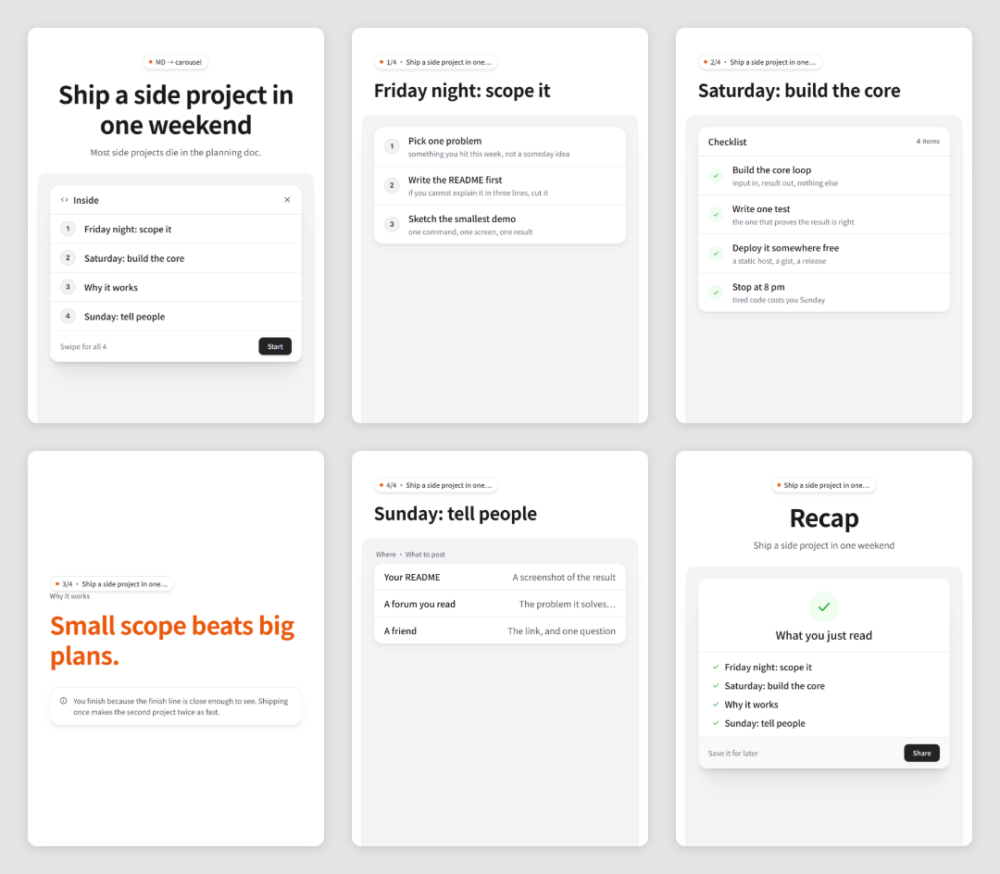
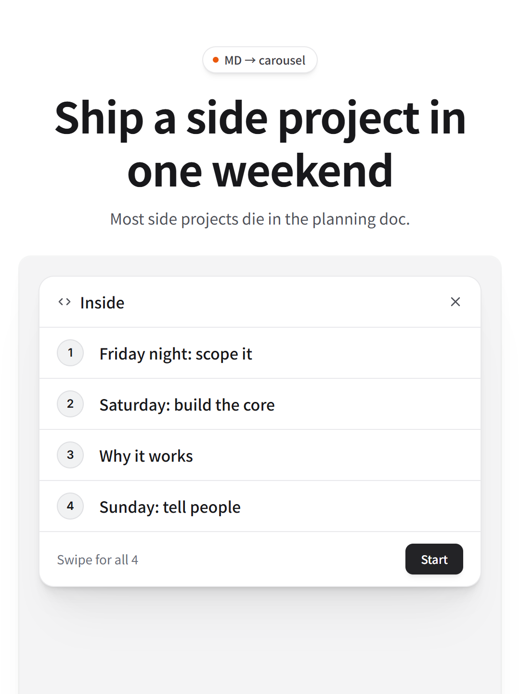
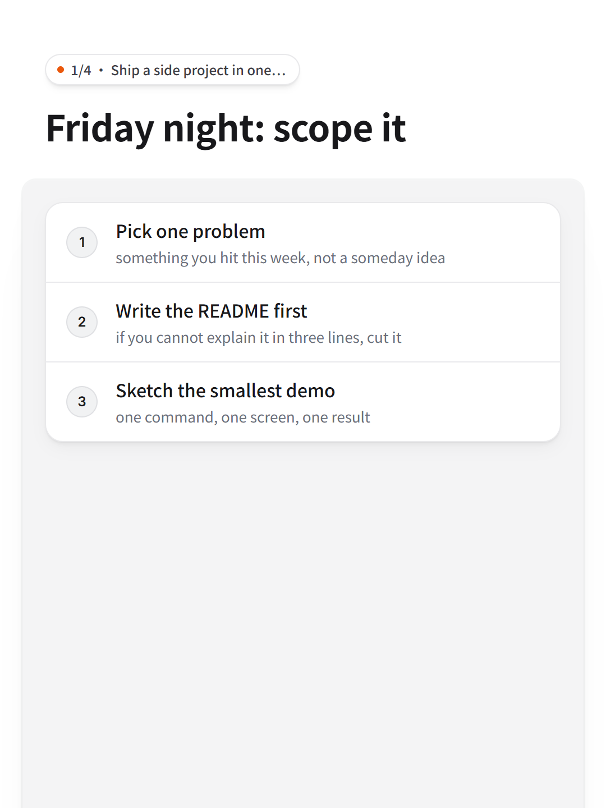
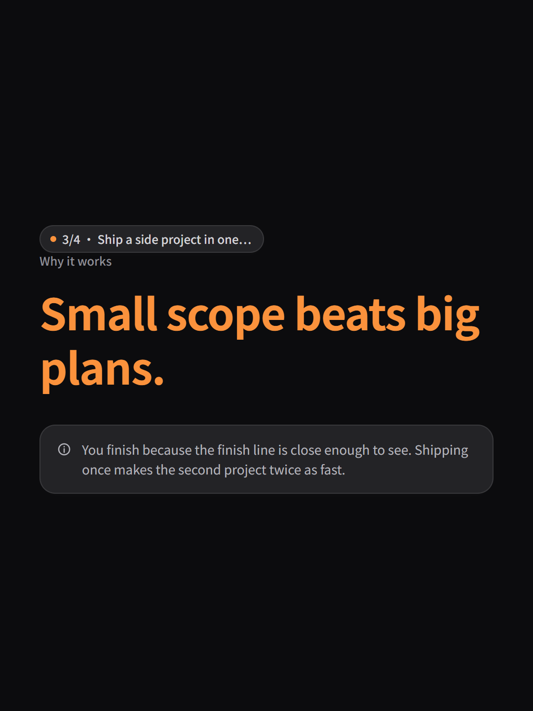
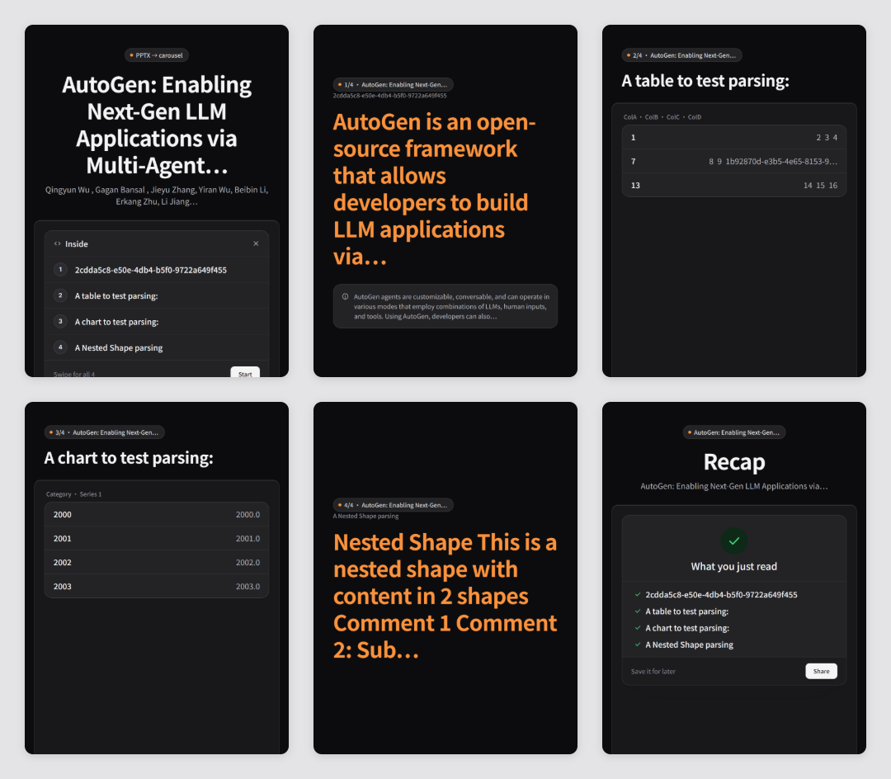
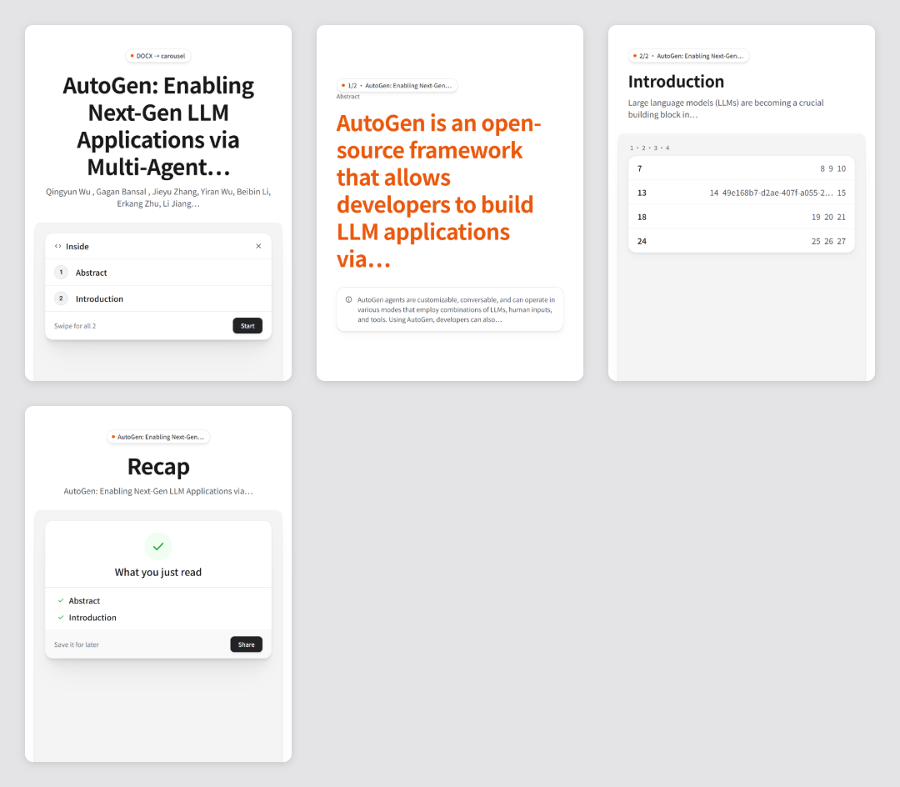
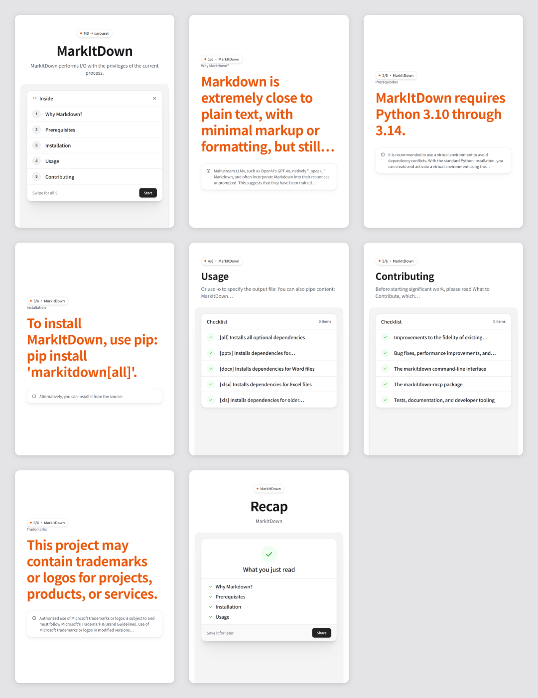

<div align="center">

# doc2carousel

**Turn any Word doc, slide deck or Markdown file into a ready-to-post 3:4 carousel.**

Microsoft's [markitdown](https://github.com/microsoft/markitdown) reads the document; the product-UI slide style of [ian-xhs-carousel](https://github.com/helloianneo/ian-xhs-carousel) lays it out. One command, no API key, nothing to install but Python.

 

Works with **Claude Code** and **Codex**.



</div>

Every image on this page is a real `python doc2carousel.py` run on the files named under it.

## Quick start
```bash
git clone https://github.com/Dodai0419/doc2carousel && cd doc2carousel
python doc2carousel.py examples/weekend.md -o out
```
```text
doc2carousel: weekend.md -> 6 slides (cover, steps, checklist, statement, table, end)
  wrote 6 PNGs (1080x1440) to out, plus overview.png and carousel.html
```
Then try your own file: `python doc2carousel.py report.docx -o out` or `python doc2carousel.py deck.pptx --theme dark -o out`.

Python 3.8+ and the Chrome or Edge you already have. No pip install, no Playwright browser download, no network.

## The problem
- A carousel is the post format that gets saved and shared, but laying out 6-10 slides by hand takes an hour.
- The content already exists: a report in Word, a talk in PowerPoint, a README, meeting notes.
- AI design tools want an account, a credit card, or a prompt you have to retype the whole document into.

## The solution
| Idea | Fixes |
|------|-------|
| **Read the file you have** (markitdown's .docx/.pptx logic, stdlib only) | Headings, lists, tables, charts and slide titles come over without copy-paste |
| **One layout per kind of content** | Numbered list becomes steps, bullets a checklist, a table a table card, prose one big sentence |
| **A real design system** (ian-xhs-carousel's CSS: zinc neutrals, one orange accent, cards on a tray) | Slides look like screenshots of a polished app, in light or dark |
| **Screenshots from your own browser** | 1080x1440 PNGs ready for Instagram, LinkedIn or Xiaohongshu, plus an overview sheet |

## Gallery

**A Markdown plan** (`examples/weekend.md`), cover and the steps slide at full size:

<p>


</p>

**The same file with `--theme dark`**, the statement slide:



**A PowerPoint deck** (markitdown's own `test.pptx`, `--theme dark`): the title slide becomes the cover, the table and the chart's data become table cards.



**A Word document** (markitdown's `test.docx`): the Title paragraph is the cover, Heading 1 sections become slides.



**A real README** (markitdown's `README.md`, 8 slides with the default `--max 10`): code blocks, badges and links are cleaned out.



## What it reads
| Input | How |
|-------|-----|
| `.docx` | Paragraphs, Heading 1-6, Title, bullet and numbered lists, tables, Word equations as LaTeX (`$...$` inline, `$$...$$` display; same output as markitdown for fractions, powers, subscripts, roots, brackets, big operators, functions) |
| `.pptx` | Slides in order, shapes sorted top-to-bottom then left-to-right like markitdown, title placeholder as `#`, tables, chart data, grouped shapes, picture alt text, speaker notes |
| `.html` | Headings, paragraphs, list items, table rows; scripts and styles dropped |
| `.md`, `.txt` | As is; fenced code, images, badges, links and GitHub alerts cleaned up |

`python doc2carousel.py FILE --md` prints the Markdown it read, so you can check it.

## Options
```bash
python doc2carousel.py FILE -o out             # PNGs + overview.png + carousel.html
python doc2carousel.py FILE --theme dark       # dark version, same layout
python doc2carousel.py FILE --max 7            # at most 7 slides, cover and recap included
python doc2carousel.py FILE --no-png           # carousel.html only
CHROME=/path/to/chromium python doc2carousel.py FILE
```

Text never gets smaller to fit: long titles and sentences are cut at a word boundary with an ellipsis, as the source design system asks. Nothing is rewritten or invented; edit your document and run again.

## Use with Claude Code
```bash
/plugin marketplace add Dodai0419/doc2carousel
/plugin install doc2carousel@doc2carousel
```
Then: "turn docs/launch-plan.docx into a carousel, dark theme".

## Use with Codex (ChatGPT)
```bash
git clone https://github.com/Dodai0419/doc2carousel && cp -r doc2carousel/skills/* ~/.codex/skills/
```
Or copy `AGENTS.md` into your project root.

## Same output as upstream
- **Reading:** every line of text markitdown 0.1.9 extracts from its own `test.docx` and `test.pptx` (title, headings, paragraphs, table cells, chart rows, grouped shapes) appears in doc2carousel's Markdown in the same order, and its `equations.docx` comes out identical (4 equations as LaTeX). Image lines are not compared. See `tests/test_doc2carousel.py::Convert`.
- **Slides:** the 6 slides of `examples/weekend.md` pass ian-xhs-carousel's own `render.py` layout check (allowed font sizes, one orange accent per slide): it printed `OK` for all six in the benchmark run below.
- **Not the same:** markitdown reads 20+ formats (PDF, Excel, audio, YouTube ...); this repo reads five. Rare equation objects (matrices, equation arrays, limits, accents) keep their text but not their LaTeX layout. Upstream renders at 2x and downsamples; this repo screenshots at 1x (1080x1440 either way).

## Benchmarks
Windows 11, Python 3.11.1, Chrome installed; markitdown 0.1.9 (`7482c09`), ian-xhs-carousel `render.py` with Playwright 1.64.1 pointed at the same Chrome (`channel="chrome"`). Command: `python bench/bench.py path/to/ian-xhs-carousel`, four runs:

| | upstream | this repo |
|-|-|-|
| convert `test.docx` (median of 20) | 256 / 379 / 329 / 287 ms | 14 / 17 / 7 / 9 ms |
| convert `test.pptx` (median of 20) | 182 / 189 / 178 / 216 ms | 18 / 25 / 23 / 20 ms |
| import time (new process) | 2.35 / 2.66 / 2.46 / 2.69 s | 0.39 / 0.49 / 0.46 / 0.45 s |
| render the 6 weekend slides + overview to PNG | 25.7 / 26.4 / 23.0 / 24.9 s | 7.9 / 8.1 / 9.5 / 9.8 s |
| runtime dependencies | markitdown[docx,pptx] (mammoth, python-pptx, lxml, markdownify, beautifulsoup4, ...), playwright, pillow | none (stdlib + an installed Chrome/Edge) |
| lines of code | 1,654 (markitdown core + docx/pptx/html converters) + 998 for Word equations (`omml.py`, `latex_dict.py`, `pre_process.py`, `wc -l`) + 170 (`render.py`) | 621 (`doc2carousel.py`, equations included), plus the 420-line CSS |

Most of upstream's render time is fixed waits it adds on purpose (1.5 s to settle, then 0.8 s + 0.3 s per slide) and the 2x capture; doc2carousel waits for `document.fonts.ready` instead and talks to Chrome directly over the DevTools protocol in one browser session.

## Inspired by
- [microsoft/markitdown](https://github.com/microsoft/markitdown) — how to read .docx and .pptx into Markdown; its test files are this repo's fixtures.
- [helloianneo/ian-xhs-carousel](https://github.com/helloianneo/ian-xhs-carousel) — the 3:4 design system (CSS) and slide templates.

## Roadmap
- [ ] PDF input (text layer only).
- [ ] Keep the first image of a section on its slide.
- [ ] `--size 1080x1350` for Instagram's 4:5.

## License
MIT. Includes MIT-licensed material from markitdown and ian-xhs-carousel; see NOTICE.
